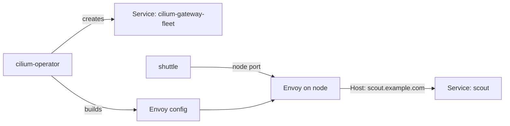

# Gateway API Resources In Cilium

The Ingress resource describes a listener, the routes and the TLS settings in one object. The Gateway API splits that work over several resources, so that one team can own the entry point and another team can own the routes. This part enables the Cilium Gateway API controller, creates a `Gateway` and an `HTTPRoute`, and shows what Cilium builds from them.

## The resources and who owns them

The **Gateway API** is a set of Kubernetes custom resources for traffic routing. A **GatewayClass** names a controller, like an IngressClass does. A **Gateway** is a request to run a listener with an address, a port and a protocol, using one GatewayClass. An **HTTPRoute** holds HTTP matching rules and backends, and it attaches to a Gateway through `parentRefs`. The three resources are in the API group `gateway.networking.k8s.io`.

Cilium implements the GatewayClass named `cilium`. Cilium programs only the Gateway resources that use this class. Check that the CRDs and the class exist:

<!-- astrona:playground:renew -->

```sh
kubectl get crd | grep gateway.networking.k8s.io
kubectl get gatewayclass
```

The CRD list holds `gatewayclasses`, `gateways`, `httproutes`, `grpcroutes`, `referencegrants` and more. The class `cilium` has the controller name `io.cilium/gateway-controller`, and its `ACCEPTED` column shows `True` when the Cilium operator has accepted it.

## Prerequisites for the controller

The Gateway API CRDs must exist before the Cilium operator starts, because the operator registers its watches at start. The Cilium Helm chart does not install the CRDs. The playground applied the CRD manifest from the Gateway API release first, and then installed Cilium with these values:

```text
kubeProxyReplacement=true
gatewayAPI.enabled=true
```

If you enable the Gateway API after Cilium is running, install the CRDs, set the value, and restart `deployment/cilium-operator` and `daemonset/cilium`. A Gateway of the class `cilium` is never programmed when a required CRD is missing at operator start.

## Create a Gateway

Save this as `gateway-fleet.yaml`:

```yaml
apiVersion: gateway.networking.k8s.io/v1
kind: Gateway
metadata:
  name: fleet
  namespace: starfleet
spec:
  gatewayClassName: cilium
  listeners:
    - name: web
      protocol: HTTP
      port: 80
      allowedRoutes:
        namespaces:
          from: Same
```

The Gateway has one listener named `web` for HTTP on port 80. The field `allowedRoutes.namespaces.from: Same` lets only routes in the namespace `starfleet` attach to this listener. Apply it and read what Cilium created:

```sh
kubectl apply -f gateway-fleet.yaml
kubectl -n starfleet get gateway fleet
kubectl -n starfleet get service cilium-gateway-fleet
```

The operator created the Service `cilium-gateway-fleet` of type `LoadBalancer`, the same pattern as the dedicated Ingress mode. On kind, the Gateway has no external address, so you use the node port again.

## Create an HTTPRoute

Save this as `httproute-scout.yaml`:

```yaml
apiVersion: gateway.networking.k8s.io/v1
kind: HTTPRoute
metadata:
  name: scout
  namespace: starfleet
spec:
  parentRefs:
    - name: fleet
  hostnames:
    - scout.example.com
  rules:
    - matches:
        - path:
            type: PathPrefix
            value: /
      backendRefs:
        - name: scout
          port: 80
```

The `parentRefs` entry attaches the route to the Gateway `fleet`. The route has one rule: every path under `/` for the host `scout.example.com` goes to port 80 of the Service `scout`. Apply it and send a request:

```sh
kubectl apply -f httproute-scout.yaml
NODE_IP=$(kubectl get node -l '!node-role.kubernetes.io/control-plane' -o jsonpath='{.items[0].status.addresses[?(@.type=="InternalIP")].address}')
NODE_PORT=$(kubectl -n starfleet get service cilium-gateway-fleet -o jsonpath='{.spec.ports[0].nodePort}')
kubectl -n starfleet exec deploy/shuttle -- curl -s -m 5 -H 'Host: scout.example.com' "http://$NODE_IP:$NODE_PORT/"
```

The reply is the podinfo JSON document. If the first request fails, wait a few seconds and send it again, because the operator and Envoy need a moment to apply the new configuration.

## What Cilium builds

The Cilium operator watches the Gateway and the HTTPRoute together. It builds the Service for the listener and one Envoy configuration that holds the listener and the route rules. The Envoy proxy on each node receives that configuration through the Cilium agent. The path of a request is the same as for an Ingress:



The diagram shows that the operator prepares the entry point and the configuration, and that the request itself passes only through Envoy. The GatewayClass, the Gateway and the HTTPRoute are inputs. They carry no traffic.

## Who owns which resource

The split is the main reason the Gateway API exists. A platform team creates the Gateway and decides the ports, the protocols and which namespaces may attach routes. An application team creates HTTPRoute resources in its own namespace and decides the paths and the backends. In the playground you act as both. The field `allowedRoutes` is the control that the platform team uses: with `from: Same`, a route in `outpost` cannot attach to the Gateway in `starfleet`.

## Common pitfalls

> [!WARNING]
> Install the Gateway API CRDs before Cilium starts, or restart the operator after you install them. A Gateway that uses a class other than `cilium` is not programmed by Cilium. A route in another namespace stays unattached when the listener has `from: Same`. On kind, send requests to the node port of the Service `cilium-gateway-<gateway name>`, because the Gateway never gets an external address.
