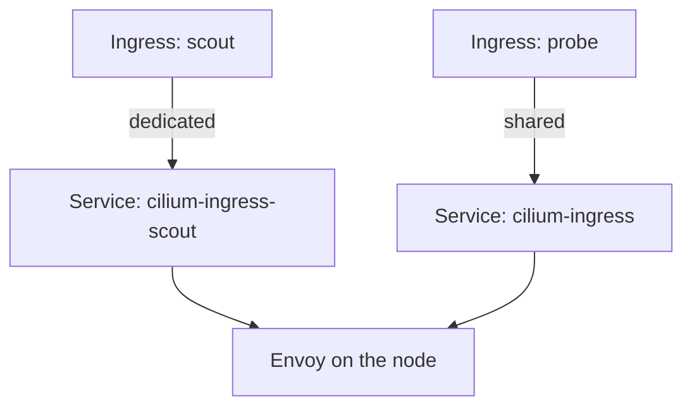

# Shared And Dedicated Entry Points

Every Ingress needs an address that clients can send requests to. Cilium can give each Ingress its own address or let all Ingress resources share one. The choice changes the number of addresses you pay for, the way two Ingress resources can collide, and the way you debug a broken route. This part creates Ingress resources in both modes and shows where the entry point lives each time.

## One Service per Ingress in dedicated mode

The Helm value `ingressController.loadbalancerMode` has two values. With `dedicated`, the Cilium operator creates one Service of type `LoadBalancer` for every Ingress. The Service is named `cilium-ingress-` followed by the Ingress name and lives in the namespace of the Ingress. The playground uses this mode.

Save this as `ingress-scout.yaml`:

```yaml
apiVersion: networking.k8s.io/v1
kind: Ingress
metadata:
  name: scout
  namespace: starfleet
spec:
  ingressClassName: cilium
  rules:
    - host: scout.example.com
      http:
        paths:
          - path: /
            pathType: Prefix
            backend:
              service:
                name: scout
                port:
                  number: 80
```

Apply it:

<!-- astrona:playground:renew -->

```sh
kubectl apply -f ingress-scout.yaml
```

Then list the Services in the namespace:

```sh
kubectl -n starfleet get service
```

The list contains a Service named `cilium-ingress-scout`. On kind it has no external address, because nothing answers the request for a load balancer. Its node ports still work.

## Change the mode for one Ingress

The annotation `ingress.cilium.io/loadbalancer-mode` overrides the Helm value for one Ingress. Save a second Ingress as `ingress-probe.yaml` with the value `shared`:

```yaml
apiVersion: networking.k8s.io/v1
kind: Ingress
metadata:
  name: probe
  namespace: starfleet
  annotations:
    ingress.cilium.io/loadbalancer-mode: shared
spec:
  ingressClassName: cilium
  rules:
    - host: probe.example.com
      http:
        paths:
          - path: /
            pathType: Prefix
            backend:
              service:
                name: probe
                port:
                  number: 80
```

Apply it and look for Services:

```sh
kubectl apply -f ingress-probe.yaml
kubectl get service -A | grep cilium-ingress
```

The shared Ingress has no Service in `starfleet`. It uses the Service `cilium-ingress` in `kube-system`, the namespace where Cilium runs. All Ingress resources in shared mode use that one Service and that one address. Envoy tells them apart by the `Host` header and the path, so two shared Ingress resources must not claim the same host and path.



The diagram shows that both modes end in the same Envoy proxy on the node. Only the Service in front of it differs.

## Choose the Service type

By default the entry point Service has the type `LoadBalancer`. Two settings change that. The Helm value `ingressController.service.type` sets the type of the shared Service. The annotation `ingress.cilium.io/service-type` sets it for one dedicated Ingress, with the values `LoadBalancer` and `NodePort`. A `NodePort` Service needs no load balancer controller, which is often the right choice on a bare-metal cluster that has no address pool. Set it on the scout Ingress:

```sh
kubectl -n starfleet annotate ingress scout ingress.cilium.io/service-type=NodePort --overwrite
kubectl -n starfleet get service cilium-ingress-scout
```

The Service now shows the type `NodePort`. For a `NodePort` Service you can also pin the ports with the annotations `ingress.cilium.io/insecure-node-port` for HTTP and `ingress.cilium.io/secure-node-port` for HTTPS. A pinned port must lie in the node port range of the cluster, which is 30000 to 32767 unless the administrator changed it.

## Which mode to choose

Use dedicated mode when teams own their Ingress resources and need isolation, because a mistake in one Ingress cannot change the routing of another. Use shared mode when addresses are scarce or when a firewall rule must name one address. The cost of shared mode is that one Ingress with a broad path rule can take requests that another team expected.

Delete the probe Ingress so the next part starts from one Ingress:

```sh
kubectl -n starfleet delete ingress probe
```

You now know that the mode decides which Service fronts Envoy. The open question is how Envoy decides which backend gets a request once it arrives.

## Common pitfalls

> [!WARNING]
> Changing the mode of an existing Ingress can move it to another Service and another address, and open connections break. A Service of `<pending>` external address on kind is normal. Two shared Ingress resources with the same host and path compete for the same requests, so give every shared Ingress its own host or path. A pinned node port outside the cluster node port range makes the Service fail to create.
