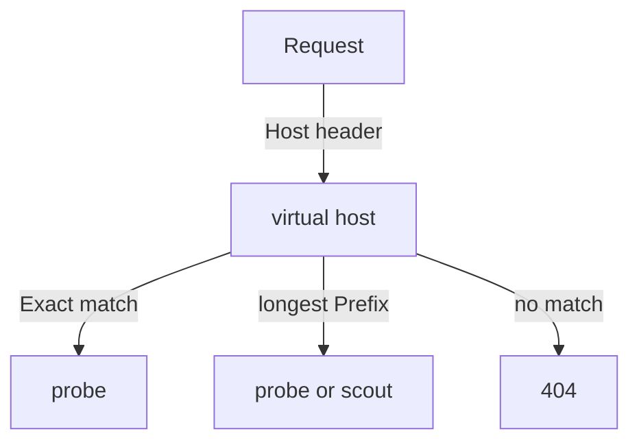

# Host And Path Matching

When many rules exist, the proxy must pick exactly one backend for each request. A wrong choice sends a request to the wrong service, and the client sees a reply that looks valid. This part shows how Envoy matches the host first and the path second, and how the three path types of the Ingress resource behave when several rules could match.

## Host first, then path

Envoy chooses a virtual host from the `Host` header of the request. A rule with `host: scout.example.com` matches only that name. A rule with a wildcard such as `*.example.com` matches one extra label, so `a.example.com` matches and `a.b.example.com` does not. A rule without a `host` field matches every host name that no other rule claims. Inside the chosen host, Envoy compares the request path with the path rules.

## The three path types

The field `pathType` is required on every path. Kubernetes defines three values:

- `Exact` matches only the same path, character for character. `/get` does not match `/get/` or `/get/1`.
- `Prefix` matches by path elements, split at `/`. The value `/status` matches `/status` and `/status/200`. It does not match `/statusx`.
- `ImplementationSpecific` leaves the meaning to the controller. Cilium treats the value as a regular expression.

Save this as `ingress-probe-paths.yaml`:

```yaml
apiVersion: networking.k8s.io/v1
kind: Ingress
metadata:
  name: probe-paths
  namespace: starfleet
spec:
  ingressClassName: cilium
  rules:
    - host: paths.example.com
      http:
        paths:
          - path: /get
            pathType: Exact
            backend:
              service:
                name: probe
                port:
                  number: 80
          - path: /status
            pathType: Prefix
            backend:
              service:
                name: probe
                port:
                  number: 80
          - path: /
            pathType: Prefix
            backend:
              service:
                name: scout
                port:
                  number: 80
```

The first two rules go to `probe`, and the last rule is a catch-all that goes to `scout`. Apply it:

<!-- astrona:playground:renew -->

```sh
kubectl apply -f ingress-probe-paths.yaml
```

## Send requests and read the result

Read the node address and the node port of the new entry point, and define a small helper that prints only the status code:

```sh
NODE_IP=$(kubectl get node -l '!node-role.kubernetes.io/control-plane' -o jsonpath='{.items[0].status.addresses[?(@.type=="InternalIP")].address}')
NODE_PORT=$(kubectl -n starfleet get service cilium-ingress-probe-paths -o jsonpath='{.spec.ports[?(@.name=="http")].nodePort}')
code() { kubectl -n starfleet exec deploy/shuttle -- curl -s -m 5 -o /dev/null -w '%{http_code}\n' -H 'Host: paths.example.com' "http://$NODE_IP:$NODE_PORT$1"; }
```

Test four paths:

```sh
code /get
code /get/extra
code /status/204
code /other
```

The request for `/get` reaches go-httpbin and returns `200`. The request for `/get/extra` does not match the `Exact` rule, so the catch-all sends it to podinfo, which does not know the path and answers `404`. The request for `/status/204` matches the `Prefix` rule and go-httpbin answers with the status `204`. The request for `/other` goes to podinfo and returns `404`. The same status code for two different reasons is why you must look at the body, not only the code, when you test routing.

## How Envoy picks one rule

When several paths could match, the Ingress specification says the longest matching path wins, and an `Exact` match beats a `Prefix` match of the same value. That is why `/get/extra` falls through to `/` and not to `/get`. The order of the rules in the YAML does not decide. You can write the catch-all first and the result is the same.



The diagram shows the order of the decision: the host selects the group of rules, then the most specific path inside the group selects the backend.

## ImplementationSpecific is a regular expression

With `pathType: ImplementationSpecific`, a value such as `/api/v[0-9]+/.*` is a regular expression. A dot matches any character, so a path with a literal dot must escape it. Use `Prefix` for ordinary paths and keep `ImplementationSpecific` for the few cases where you need a pattern. The same Ingress in another controller can mean something different, so the manifest is not portable.

## Common pitfalls

> [!WARNING]
> `Prefix` works on whole path elements, so `/status` does not match `/statusx`. Rule order in the YAML does not set the priority: the longest match does. A catch-all rule hides a typo in a more specific path, because the request still gets a reply. Do not rely on `ImplementationSpecific` if you plan to move the manifest to another controller.
