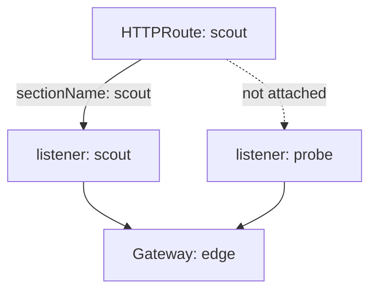

# Listeners And Attachment

A Gateway with no listener accepts no traffic. Each listener opens one combination of port, protocol and host name, and it also says which routes may use it. This part creates a Gateway with two HTTP listeners, attaches a route to one of them and reads how many routes each listener has accepted.

## The fields of a listener

A **listener** is one entry in `spec.listeners` of a Gateway. It has these fields:

- `name` identifies the listener inside the Gateway. A route can use it as `sectionName`.
- `port` is the port on which the Gateway accepts connections.
- `protocol` is `HTTP`, `HTTPS`, `TLS`, `TCP` or `UDP`. The protocol decides which route kinds can attach.
- `hostname` is optional. When it is set, the listener serves only requests for that host name. A leading wildcard such as `*.example.com` is allowed.
- `allowedRoutes` limits which namespaces and which route kinds may attach.

Two listeners may share a port when their host names differ.

## Create a Gateway with two listeners

Save this as `gateway-edge.yaml`:

```yaml
apiVersion: gateway.networking.k8s.io/v1
kind: Gateway
metadata:
  name: edge
  namespace: starfleet
spec:
  gatewayClassName: cilium
  listeners:
    - name: scout
      protocol: HTTP
      port: 80
      hostname: scout.example.com
      allowedRoutes:
        namespaces:
          from: Same
    - name: probe
      protocol: HTTP
      port: 80
      hostname: probe.example.com
      allowedRoutes:
        namespaces:
          from: Same
```

Both listeners use port 80 and differ by host name. Apply it:

<!-- astrona:playground:renew -->

```sh
kubectl apply -f gateway-edge.yaml
```

Cilium creates a Service named `cilium-gateway-edge` for the Gateway. Check it:

```sh
kubectl -n starfleet get gateway edge
kubectl -n starfleet get service cilium-gateway-edge
```

The Gateway shows the class `cilium`. Without a load balancer controller the Service has no external address. The node ports still work.

## Attach a route to one listener

A route attaches to a Gateway through `parentRefs`. Adding `sectionName` limits the attachment to one listener. Save this as `httproute-scout.yaml`:

```yaml
apiVersion: gateway.networking.k8s.io/v1
kind: HTTPRoute
metadata:
  name: scout
  namespace: starfleet
spec:
  parentRefs:
    - name: edge
      sectionName: scout
  hostnames:
    - scout.example.com
  rules:
    - backendRefs:
        - name: scout
          port: 80
```

Apply it and read how many routes each listener has accepted:

```sh
kubectl apply -f httproute-scout.yaml
kubectl -n starfleet get gateway edge -o jsonpath='{range .status.listeners[*]}{.name}={.attachedRoutes}{"\n"}{end}'
```

The listener `scout` shows one attached route and the listener `probe` shows none. The count is the quick check that a route reached the listener you meant.

## How the host names combine

A route may set `hostnames` too. The route is accepted only when its host names overlap with the host name of the listener. A route for `probe.example.com` that names the listener `scout` has no host name in common with it, so the Gateway does not accept it. A route with no `hostnames` inherits the host name of the listener.

## Restrict namespaces and kinds

The field `allowedRoutes.namespaces.from` has three values. `Same` allows routes from the namespace of the Gateway. `All` allows every namespace. `Selector` allows the namespaces that match a label selector. The field `allowedRoutes.kinds` lists route kinds, for example `HTTPRoute`. Without it, the protocol of the listener decides: an `HTTP` listener takes `HTTPRoute`. A listener that allows one kind rejects a route of another kind, even from the same namespace.



The diagram shows that one Gateway holds several listeners and that a route attaches to the listener named in `sectionName`.

## Common pitfalls

> [!WARNING]
> A `sectionName` that does not match a listener name leaves the route unattached. A route whose host names do not overlap with the listener host name is not accepted. `from: Same` rejects routes from other namespaces without an error in the route manifest, so read the route status. Two listeners with the same port, protocol and host name conflict.
