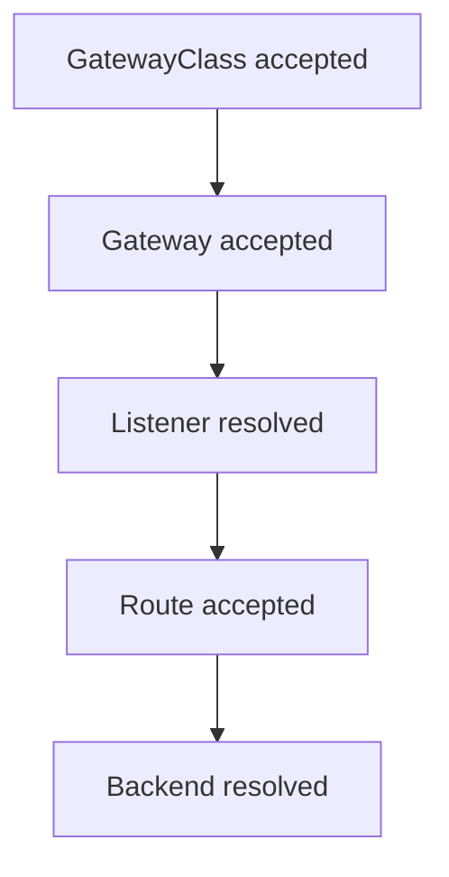

# Reading Listener Status

When a Gateway does not serve traffic, the manifest rarely says why. The controller writes the answer into the `status` of the Gateway, its listeners and its routes. This part reads these conditions in the order that finds a fault fastest, and breaks a listener on purpose to see how the status changes.

## The conditions and what they mean

A **condition** is a status entry with a `type`, a `status` of `True` or `False`, a `reason` and a `message`. Three levels carry conditions:

- The `GatewayClass` has `Accepted`. It is `True` when Cilium owns the class and can use it.
- The `Gateway` has `Accepted` and `Programmed`. `Programmed` is `True` when Cilium turned the Gateway into a working configuration.
- Each listener has `Accepted`, `Programmed`, `ResolvedRefs` and `Conflicted`, and a counter `attachedRoutes`. `ResolvedRefs` is `False` when a certificate reference or a route kind cannot be resolved.

A route has its own `Accepted` and `ResolvedRefs` conditions for each parent Gateway it names.

## Read a healthy Gateway

Use a Gateway named `secure` with an HTTPS listener that refers to the Secret `scout-tls`, and an HTTPRoute that attaches to it. Read the conditions of the class, the Gateway and the listener:

<!-- astrona:playground:renew -->

```sh
kubectl get gatewayclass cilium -o jsonpath='{range .status.conditions[*]}{.type}={.status}{"\n"}{end}'
kubectl -n starfleet get gateway secure -o jsonpath='{range .status.conditions[*]}{.type}={.status} {.reason}{"\n"}{end}'
kubectl -n starfleet get gateway secure -o jsonpath='{range .status.listeners[*]}{.name} attached={.attachedRoutes}{"\n"}{range .conditions[*]}  {.type}={.status} {.reason}{"\n"}{end}{end}'
```

The class shows `Accepted=True`. The Gateway shows `Accepted=True`. The listener shows its attached route count and its own conditions. Read the `message` of any condition that is `False`, because it names the field.

## Break the certificate reference

Change the Secret name to one that does not exist and read the listener again:

```sh
kubectl -n starfleet patch gateway secure --type=json -p '[{"op":"replace","path":"/spec/listeners/0/tls/certificateRefs/0/name","value":"missing-cert"}]'
kubectl -n starfleet get gateway secure -o jsonpath='{range .status.listeners[*].conditions[*]}{.type}={.status} {.reason}{"\n"}{end}'
```

The listener shows `ResolvedRefs` as `False`, and the `reason` names an invalid certificate reference. The other listeners of the same Gateway keep working, because each listener is judged on its own. Restore the name:

```sh
kubectl -n starfleet patch gateway secure --type=json -p '[{"op":"replace","path":"/spec/listeners/0/tls/certificateRefs/0/name","value":"scout-tls"}]'
```

## A debugging order

Read the status from the outside in. First the `GatewayClass`: if it is not accepted, the Cilium controller does not own it. Then the Gateway `Accepted` and `Programmed` conditions. Then each listener: `ResolvedRefs`, `Conflicted` and `attachedRoutes`. Then the route `Accepted` and `ResolvedRefs`. At each level the first `False` condition is the one to fix, because later conditions follow from it.



The diagram shows the order of the checks. A fault at one step hides the steps after it.

## Clean up

Delete the Gateways and routes from this module and the Secret:

```sh
kubectl -n starfleet delete gateway edge secure passthrough --ignore-not-found
kubectl -n starfleet delete httproute scout secure-scout --ignore-not-found
kubectl -n starfleet delete secret scout-tls --ignore-not-found
kubectl -n outpost delete referencegrant allow-starfleet-gateways --ignore-not-found
```

## Common pitfalls

> [!WARNING]
> `attachedRoutes: 0` means no route reached the listener, which can be a `sectionName`, a namespace or a host name mismatch. A condition message can be long, so print it with `jsonpath` instead of reading a truncated table. A listener can be `ResolvedRefs=False` while the Gateway itself is `Accepted=True`. Fix the first `False` condition before you look at the next one.
