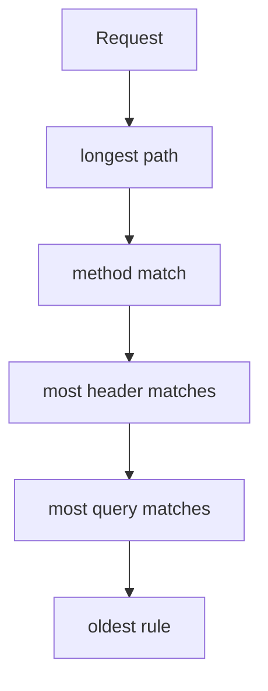

# Request Matching And Rule Precedence

A route with one rule sends everything to one place. A route with several rules must decide which rule owns a request, and the answer must not depend on the order of the rules in the file. This part creates a Gateway, writes rules that match on path, header, query parameter and method, and shows how the Gateway API ranks them.

## A Gateway to test with

Save this as `gateway-fleet.yaml`:

```yaml
apiVersion: gateway.networking.k8s.io/v1
kind: Gateway
metadata:
  name: fleet
  namespace: starfleet
spec:
  gatewayClassName: cilium
  listeners:
    - name: web
      protocol: HTTP
      port: 80
      allowedRoutes:
        namespaces:
          from: Same
```

Apply it and define helpers that read the entry point and send a request with the `Host` header `fleet.example.com`:

<!-- astrona:playground:renew -->

```sh
kubectl apply -f gateway-fleet.yaml
NODE_IP=$(kubectl get node -l '!node-role.kubernetes.io/control-plane' -o jsonpath='{.items[0].status.addresses[?(@.type=="InternalIP")].address}')
NODE_PORT=$(kubectl -n starfleet get service cilium-gateway-fleet -o jsonpath='{.spec.ports[0].nodePort}')
req() { local path="$1"; shift; kubectl -n starfleet exec deploy/shuttle -- curl -s -m 5 -H 'Host: fleet.example.com' "$@" "http://$NODE_IP:$NODE_PORT$path"; }
```

The Service `cilium-gateway-fleet` can take a few seconds to appear after the Gateway is applied. Repeat the second command until it prints a node port.

## The four match types

A rule has a list `matches`. A request matches the rule when it satisfies every field of at least one entry. Each entry can combine these fields:

- `path` has a `type` of `Exact`, `PathPrefix` or `RegularExpression` and a `value`. A prefix matches whole path elements.
- `headers` is a list of `name` and `value` pairs. The type `Exact` is the default.
- `queryParams` is a list of `name` and `value` pairs for the query string.
- `method` is an HTTP method such as `GET` or `POST`.

Save this as `httproute-fleet.yaml`. It holds four rules that use one match type each, and a default rule:

```yaml
apiVersion: gateway.networking.k8s.io/v1
kind: HTTPRoute
metadata:
  name: fleet
  namespace: starfleet
spec:
  parentRefs:
    - name: fleet
  hostnames:
    - fleet.example.com
  rules:
    - matches:
        - path:
            type: Exact
            value: /get
      backendRefs:
        - name: probe
          port: 80
    - matches:
        - headers:
            - name: x-fleet
              value: probe
      backendRefs:
        - name: probe
          port: 80
    - matches:
        - queryParams:
            - name: target
              value: probe
      backendRefs:
        - name: probe
          port: 80
    - matches:
        - method: POST
      backendRefs:
        - name: probe
          port: 80
    - backendRefs:
        - name: scout
          port: 80
```

Apply it:

```sh
kubectl apply -f httproute-fleet.yaml
```

## Send a request for each rule

Send five requests. The helper `req` prints the body, so a go-httpbin reply is JSON that names the request and a podinfo reply names podinfo:

```sh
req /get
req / -H 'x-fleet: probe'
req '/get?target=probe'
req /post -X POST
req /
```

The first four requests reach `probe` and the last one reaches `scout`. The fifth request matches no specific rule, so the rule without `matches` takes it. A rule without `matches` is the same as a match on the path prefix `/`.

## How the Gateway API ranks matches

When several rules match, the Gateway API defines the order. The rule with the most specific path wins: an `Exact` path beats a prefix, and a longer prefix beats a shorter one. When the paths tie, the rule with the `method` match wins. When that ties, the rule with more header matches wins, and then the rule with more query parameter matches. When all of these tie, the rule that is older, and then first in the list, wins.

You can see this with the request `/get` plus the header: it matches both the `Exact` path rule and the header rule, and the path rule wins because path comes first in the order.



The diagram shows the tie-break order. Each step applies only when all steps before it tie.

## Regular expressions and case

A path match with the type `RegularExpression` is an extended feature, and its meaning depends on the implementation. Prefer `PathPrefix` and `Exact` for portable routes. Header names are not case sensitive, but header values and query parameter values are.

## Common pitfalls

> [!WARNING]
> The order of rules in the file does not set the priority. A rule without `matches` is the default for the path `/`. Two entries inside one `matches` list are alternatives (either one), but several fields inside one entry must all match. A query parameter match reads the query string only, so put it in `queryParams` and not in the path value.
