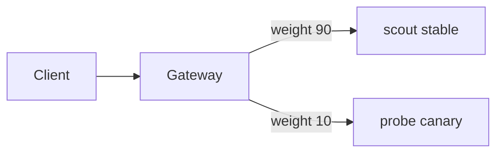

# Weighted Backends For Canary And Blue-Green

A release is safer when only a few users get the new version first. The Gateway API supports this with the `weight` field on each backend of a rule. This part splits traffic between two versions, shifts it step by step and rolls it back.

## How weights work

Each entry in `backendRefs` can have a `weight` (default 1). A backend receives its weight divided by the sum of all weights. A weight of `0` receives nothing. The weights are not percentages, and 90 and 10 give the same split as 9 and 1. The split is statistical: a small number of requests will not match it exactly.

## A canary split

For the test, treat `scout` as the stable version and `probe` as the canary. The two return different bodies, so you can see which one answered. Save this as `httproute-canary.yaml`:

```yaml
apiVersion: gateway.networking.k8s.io/v1
kind: HTTPRoute
metadata:
  name: canary
  namespace: starfleet
spec:
  parentRefs:
    - name: fleet
  hostnames:
    - canary.example.com
  rules:
    - backendRefs:
        - name: scout
          port: 80
          weight: 90
        - name: probe
          port: 80
          weight: 10
```

Apply it and send 50 requests, counting the answers that came from go-httpbin. The go-httpbin root page contains the text `go-httpbin`:

<!-- astrona:playground:renew -->

```sh
kubectl apply -f httproute-canary.yaml
NODE_IP=$(kubectl get node -l '!node-role.kubernetes.io/control-plane' -o jsonpath='{.items[0].status.addresses[?(@.type=="InternalIP")].address}')
NODE_PORT=$(kubectl -n starfleet get service cilium-gateway-fleet -o jsonpath='{.spec.ports[0].nodePort}')
for i in $(seq 1 50); do kubectl -n starfleet exec deploy/shuttle -- curl -s -m 5 -H 'Host: canary.example.com' "http://$NODE_IP:$NODE_PORT/" | grep -c 'httpbin'; done | sort | uniq -c
```

Most answers come from `scout`, and a few come from `probe`. The count of `1` lines is about five, but it varies from run to run.

## Shift and roll back

To move on, edit the two numbers, for example 50 and 50, then 0 and 100. To roll back, set the canary weight to `0` and apply again. One field change is the whole rollback, with no pod restart. For a blue-green switch, give the old version the weight 100 and the new one 0, test the new one through a header match, then flip the numbers.

## Canary for testers only

Weights mix with matches. A rule that matches the header `x-canary: 1` and sends all traffic to the new version lets testers use it while the public uses the old one. Two rules do this: the header rule wins by the precedence order from the first part, and the default rule keeps the public on the stable version.



The diagram shows the split. Change the labels, and the traffic moves.

## Common pitfalls

> [!WARNING]
> A weight is a share and not a percentage, so 1 and 1 is 50 and 50. A backend with weight 0 stays in the route but gets no traffic. A very low request count shows a split that looks wrong, so judge with many requests. Weights do not check that the canary is healthy: watch errors yourself before you raise the number.
