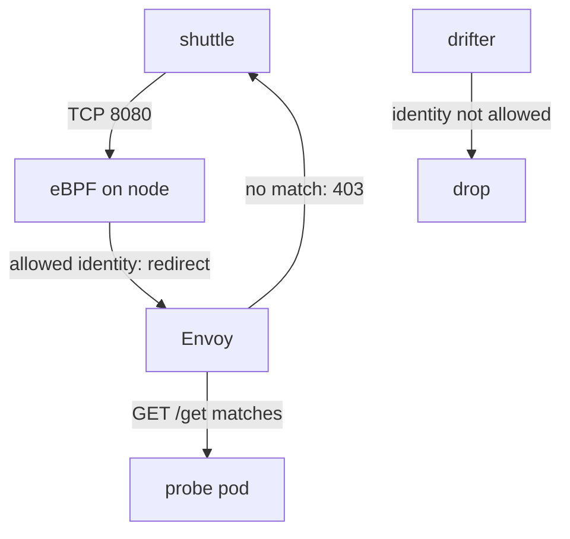

# Layer 7 Access Control With CiliumNetworkPolicy

A rule on a port decides whether a client may connect. It cannot decide whether the client may call `DELETE /accounts` or only `GET /health`. For that, the proxy must read the HTTP request. This part writes a `CiliumNetworkPolicy` with an HTTP rule, follows what Envoy does with each request, and shows the three different ways a request can fail.

## A policy with an HTTP rule

A **CiliumNetworkPolicy** is a Cilium custom resource that selects pods and lists the traffic allowed to them. An HTTP rule is added under `toPorts` in the field `rules.http`. Each entry can set `method`, `path`, `host` and `headers`. The values of `method`, `path` and `host` are regular expressions that must match the whole value.

Save this as `policy-probe-http.yaml`:

```yaml
apiVersion: cilium.io/v2
kind: CiliumNetworkPolicy
metadata:
  name: probe-http
  namespace: starfleet
spec:
  endpointSelector:
    matchLabels:
      app: probe
  ingress:
    - fromEndpoints:
        - matchLabels:
            app: shuttle
      toPorts:
        - ports:
            - port: "8080"
              protocol: TCP
          rules:
            http:
              - method: GET
                path: "/get"
              - method: GET
                path: "/status/.*"
```

The policy allows the pods labelled `app=shuttle` to send `GET /get` and `GET` for any path under `/status/` to the pods labelled `app=probe` on port 8080. The pod port is 8080, because the Service `probe` maps its port 80 to the target port 8080, and policy applies to the pod port. Apply it:

<!-- astrona:playground:renew -->

```sh
kubectl apply -f policy-probe-http.yaml
```

## Three outcomes for three requests

Send three requests from `shuttle` and one from `drifter`:

```sh
kubectl -n starfleet exec deploy/shuttle -- curl -s -m 5 -o /dev/null -w '%{http_code}\n' http://probe.starfleet.svc/get
kubectl -n starfleet exec deploy/shuttle -- curl -s -m 5 -w ' %{http_code}\n' http://probe.starfleet.svc/uuid
kubectl -n starfleet exec deploy/shuttle -- curl -s -m 5 -w ' %{http_code}\n' -X POST http://probe.starfleet.svc/post
kubectl -n outpost exec deploy/drifter -- curl -s -m 5 -o /dev/null -w '%{http_code}\n' http://probe.starfleet.svc/get
```

The results show three different behaviours:

- `GET /get` from `shuttle` returns `200`. The request matches a rule, so Envoy forwards it to `probe`.
- `GET /uuid` and `POST /post` from `shuttle` return `403`, with the body `Access denied`. The connection was allowed, but Envoy read the request, found no matching rule and answered itself.
- `GET /get` from `drifter` prints `000` after five seconds. The client does not match `fromEndpoints`, so the kernel drops the packets before any proxy sees a request.

The difference is the layer that decided. A `403` with the text `Access denied` is an Envoy decision. A timeout is a kernel decision.

## How the request reaches Envoy

A pod with no rule accepts all connections. When the policy selects the pods of `probe` and the rule has an HTTP part, the Cilium agent writes this into eBPF: connections to port 8080 from the allowed identities are redirected to the Envoy proxy on the same node. The agent also sends Envoy the list of HTTP rules for that port. Envoy checks each request against the list. It forwards a request that matches to the pod, and it returns `403` for any other request.



The diagram shows that eBPF decides about the connection and Envoy decides about each request. Envoy sits between the client and the pod only for connections that a Layer 7 rule selected.

## Rules are allow lists

A `CiliumNetworkPolicy` has no deny action in this form. Once a pod is selected by an ingress rule, all ingress traffic that no rule allows is denied. Several rules for the same port add up: a request is allowed if any HTTP entry matches. An entry with only `method: GET` allows `GET` on every path. An entry with only `path` allows every method on that path. Combine `method` and `path` to be exact.

Because the values are regular expressions, `path: "/get"` matches only `/get`, and `path: "/status/.*"` matches every path under `/status/`. A path with a dot or a question mark must be written with care: `.` matches any character. Test the rule with a request that must fail, not only with a request that must pass.

## Add a header condition

An HTTP entry can also require headers. Add this entry to the `http` list of the policy to allow `POST /post` only when the request has the header `x-fleet-role: operator`:

```yaml
              - method: POST
                path: "/post"
                headers:
                  - "x-fleet-role: operator"
```

After you apply the changed file, a `POST /post` with `-H 'x-fleet-role: operator'` returns `200` and the same request without the header returns `403`. The header is a value that the client sets, so it controls routing but it is not proof of identity. Treat it as an extra condition, and rely on the pod identity for who the client is.

## Remove the policy

Delete the policy so that other work in the playground starts from a clean state:

```sh
kubectl -n starfleet delete ciliumnetworkpolicy probe-http
```

## Common pitfalls

> [!WARNING]
> Write the pod port, not the Service port, in `toPorts`. A path rule that lacks a regex wildcard matches one exact path. A `403` with `Access denied` proves Envoy ran, and a timeout proves the kernel dropped the packets. A policy that selects a pod changes the default for that pod from allow to deny for the listed direction, so list every client that must still work.
