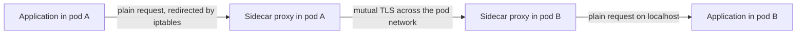

# How A Sidecar Mesh Works

A service mesh needs a component that sees every request between services. The first and best-known design puts one proxy next to every application container, in the same pod. This part explains how a sidecar gets into a pod, how traffic is forced through it, what the proxy does with the traffic, and which costs follow from having one proxy for every pod.

## What a sidecar is

A **sidecar** is a second container in the same pod as the application container. All containers of a pod share one network namespace, so they share one IP address and one set of ports, and they can talk to each other on `localhost`. A **sidecar proxy** is a sidecar that runs a network proxy, most often Envoy. It handles the network traffic of the pod so that the application does not have to.

A **proxy** is a process that receives a request and sends it on to another place. A proxy at Layer 7 understands the request: it can read the HTTP method, the path and the headers. From that, it can apply an access rule, route the request, retry it, measure it, or encrypt the connection to the next proxy.

## How the sidecar gets into the pod

A person does not add the sidecar to each manifest by hand. A **mutating admission webhook** does it. This is a web service that the Kubernetes API server calls when a pod is created. The webhook receives the pod specification and returns a changed one. For a sidecar mesh, the change adds the proxy container, and it adds an extra container or a CNI plugin step that prepares the network rules.

The webhook acts on pods in namespaces that carry a label, or on pods that carry an annotation. This has three results:

- The pod specification that you wrote is not the pod specification that runs. The running pod has more containers than your manifest lists.
- A pod that was created before the label was set has no sidecar. The webhook acts only at creation, so the pod must be recreated.
- If the webhook service is down, pod creation in the labelled namespaces can fail or can proceed without a sidecar, depending on the failure policy of the webhook.

## How traffic is forced through the proxy

The application does not know the proxy exists. It opens a connection to `probe.starfleet.svc` and sends a request. Rules in the network namespace of the pod redirect this connection to the proxy. These rules are `iptables` rules in the NAT table that match all outgoing TCP traffic of the pod, except the traffic of the proxy itself, and rewrite the destination to the port of the proxy. A second set of rules does the same for incoming traffic.

The rules must exist before the application starts to send traffic. They are written by an init container, or by a CNI plugin when the pod network is set up. An init container needs the capability `NET_ADMIN` to change the rules, which is a permission that many security policies restrict. A CNI plugin avoids this permission in the pod, but it ties the mesh to the node network setup.



One request therefore crosses two proxies. The sending proxy picks the destination, applies the rules for outgoing traffic and encrypts the connection. The receiving proxy decrypts it, applies the rules for incoming traffic and passes the request to the application on `localhost`.

## How the proxies get their configuration

A sidecar mesh has a control plane, which is a set of components that tell the proxies what to do. The proxies connect to the control plane and receive their configuration over the **xDS** protocol, which is the API that Envoy uses to receive listeners, routes, clusters and endpoints. The control plane reads Services, endpoints and the mesh policy objects, and it sends every proxy the part that applies to it.

The control plane also issues the identity of each workload. It signs a short-lived certificate for each proxy, and the proxy uses it for mutual TLS. The identity names the service account of the pod, so a rule can say which service accounts may call which services.

## What you gain

The sidecar design has real strengths:

- Isolation per workload. A crash or a bad configuration in one proxy affects one pod.
- A clear identity boundary. Each pod has its own proxy and its own certificate.
- Full Layer 7 features for every pod, because every request passes a proxy that can read it.
- No dependency on the node kernel beyond `iptables`, so it runs on almost any cluster.

## Look at a pod in the playground

The playground does not run a sidecar mesh. Cilium does not inject containers. You can see this by listing the containers of the example pods:

<!-- astrona:playground:renew -->

```sh
kubectl -n starfleet get pods -o custom-columns=NAME:.metadata.name,CONTAINERS:.spec.containers[*].name
```

Each pod lists only the container from its own manifest. In a cluster with a sidecar mesh, the same command lists an extra proxy container for every pod in a labelled namespace.

Check that Cilium has not registered a webhook that changes pods:

```sh
kubectl get mutatingwebhookconfigurations
```

The list has no entry that injects a proxy into pods. A sidecar mesh adds an entry here, which is how you can recognise one on an unknown cluster.

## Measure what a proxy for every pod costs

Count the pods that a sidecar mesh would add proxies to, and compare the count with the number of nodes:

```sh
kubectl get pods -A --no-headers | wc -l
kubectl get nodes --no-headers | wc -l
```

A sidecar mesh runs one proxy for each pod in the first number. A design with a proxy on each node runs one proxy for each node in the second number. Each proxy needs memory for its configuration, and the configuration grows with the number of services it can reach, unless the control plane limits it.

The cost has other forms too:

- **Startup order.** If the application starts before the proxy is ready, its first requests fail. If the proxy stops before the application, the application loses its connections too early. Kubernetes supports sidecar containers as init containers with `restartPolicy: Always`, which gives the proxy a defined start and stop order. Older setups use hooks and delays.
- **Jobs.** A pod of a Job finishes when all its containers end. A proxy that never ends keeps the Job from completing, unless something stops it.
- **Upgrades.** A new proxy version reaches a pod only when the pod is recreated. Upgrading the mesh means restarting the workloads, in an order that the owners of the workloads control.
- **Latency.** Each request passes through two extra user-space processes and the network stack on each side.

## What you know now

A sidecar mesh injects a proxy container into every pod with an admission webhook, redirects the traffic of the pod to it with `iptables` rules, and configures it over xDS from a control plane that also issues the identities. It isolates failures per pod and gives full Layer 7 features everywhere. It costs one proxy for each pod, a restart for each upgrade, and extra rules about startup order. The open question is how Cilium delivers the same features without a container in each pod.

## Common pitfalls

> [!WARNING]
> - A pod created before the namespace was labelled has no sidecar, and it stays without one until it is recreated.
> - Counting only application resources hides the cost. The requests and limits of the proxy are added to every pod.
> - A Job can hang if its sidecar never exits. Check how the mesh handles this before you mesh batch workloads.
> - A restart of workloads to upgrade the proxy is a change to production traffic. Plan it like a deployment.
