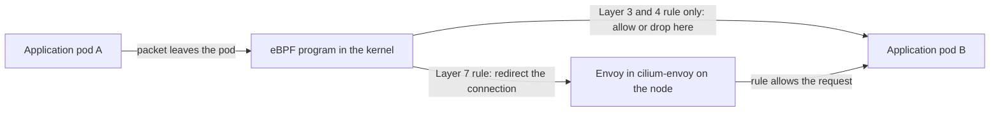

# Cilium Sidecarless Architecture

Cilium delivers service mesh features without a proxy container in each pod. The work is split between the Linux kernel, where eBPF programs handle everything that Layer 3 and Layer 4 can decide, and a shared Envoy proxy on each node, which handles only the traffic that needs Layer 7 processing. This part explains where each piece runs, how a packet finds its way to the proxy, and what changes for the pods.

## Sidecarless means no proxy container in the pod

**Sidecarless** means that the pods of your applications have no extra container for the mesh. The pod specification that you wrote is the pod that runs. Nothing injects a container, and nothing restarts the pod when the mesh changes.

It does not mean that there is no proxy. For Layer 7 rules, Cilium still uses Envoy. The difference is where Envoy runs: in a pod of its own on each node, shared by all application pods on that node.

## The pieces and where they run

Three pieces matter:

- **The Cilium agent** is a pod in a DaemonSet named `cilium`. It runs on every node, watches the Kubernetes API, and loads eBPF programs into the kernel of its node. It is also the control plane for the proxy on the same node.
- **The eBPF programs** run in the kernel. They are attached to the network devices of the pods and the node. They apply identity-based Layer 3 and Layer 4 policy, balance load across Service endpoints, and encrypt traffic, all without leaving the kernel.
- **The Envoy proxy** runs in a DaemonSet named `cilium-envoy`. One pod runs on each node. The agent sends it listeners and routes over xDS, through a socket on the node.

**eBPF** is a mechanism of the Linux kernel that runs small, verified programs at defined points, such as the arrival of a packet at a network device. Cilium uses it so that most decisions are made in the kernel with no copy of the packet in user space.

## How a request reaches the proxy

Not every request needs the proxy. The agent decides this from the policy objects. A request between two pods that only a Layer 3 or Layer 4 rule governs is handled by eBPF alone. A request that a policy with `http` rules governs, or that an Ingress or Gateway resource routes, needs Layer 7 processing.

For the second kind, the eBPF program at the pod device marks the packet and redirects the connection to the Envoy proxy on the node, with a mechanism called **TPROXY** that keeps the original destination. Envoy applies the Layer 7 rule, and then it sends the connection on to the destination. The identity of the source pod travels with the connection, so the proxy applies rules by Cilium identity, not by IP address.



Only the connections that a Layer 7 rule governs take the longer path through the proxy. All other traffic never leaves the kernel.

## What changes for the pods

Because the proxy is not in the pod, several things differ from a sidecar mesh:

- The pods start and stop as before. There is no startup order between the application and a proxy.
- Jobs finish normally. There is no proxy container to stop.
- A change to a mesh policy applies without restarting any pod. The agent updates the eBPF maps and the Envoy configuration on each node.
- The Envoy version is upgraded by a rolling update of the `cilium-envoy` DaemonSet. The application pods are not recreated.

## Look at the pieces in the playground

Start with the components. The DaemonSets show one pod for each node:

<!-- astrona:playground:renew -->

```sh
kubectl -n kube-system get daemonset cilium cilium-envoy
kubectl -n kube-system get pods -l k8s-app=cilium-envoy -o wide
```

The `DESIRED` and `READY` columns match the number of nodes that the DaemonSet runs on. The second command shows on which node each Envoy pod runs.

Ask the agent about the proxy and about the endpoints that it manages:

```sh
kubectl -n kube-system exec ds/cilium -c cilium-agent -- cilium-dbg status | grep -i proxy
kubectl -n kube-system exec ds/cilium -c cilium-agent -- cilium-dbg endpoint list
```

The first command prints the proxy status line of the agent. The second lists the pods on that node as endpoints, with their identities and whether policy is enforced for them.

## Apply a Layer 7 rule and check the pods

Save this as `probe-l7.yaml`. It allows only `GET /get` to the pod port 8080 of `probe`, and only from `shuttle`:

```yaml
apiVersion: cilium.io/v2
kind: CiliumNetworkPolicy
metadata:
  name: probe-l7
  namespace: starfleet
spec:
  endpointSelector:
    matchLabels:
      app: probe
  ingress:
    - fromEndpoints:
        - matchLabels:
            app: shuttle
      toPorts:
        - ports:
            - port: "8080"
              protocol: TCP
          rules:
            http:
              - method: GET
                path: "/get"
```

Apply it:

```sh
kubectl apply -f probe-l7.yaml
```

Then check the result. The pods are the same and have one container each, and the rule is enforced:

```sh
kubectl -n starfleet get pods -l app=probe -o custom-columns=NAME:.metadata.name,CONTAINERS:.spec.containers[*].name,AGE:.metadata.creationTimestamp
kubectl -n starfleet exec deploy/shuttle -- curl -s -m 5 -o /dev/null -w '%{http_code}\n' http://probe.starfleet.svc/get
kubectl -n starfleet exec deploy/shuttle -- curl -s -m 5 -o /dev/null -w '%{http_code}\n' -X POST http://probe.starfleet.svc/post
```

The pod list shows the same pod, with the same creation time and one container. The first request returns `200`. The second returns `403`, which the Envoy proxy on the node sends. Layer 7 enforcement was added and no pod was touched.

## Upgrade the proxy without touching the application

The proxy is its own DaemonSet, so you can restart it on its own. Restart it and watch that the application pods keep their age:

```sh
kubectl -n kube-system rollout restart daemonset/cilium-envoy
kubectl -n kube-system rollout status daemonset/cilium-envoy --timeout=180s
kubectl -n starfleet get pods
```

Requests that pass through Envoy on a node can fail for a short time while its pod restarts. The application pods are not restarted. Their `AGE` column does not reset.

## What you know now

Cilium splits the mesh into the kernel and a shared Envoy proxy on each node. The eBPF programs handle identity-based Layer 3 and Layer 4 rules, load balancing and encryption. Connections that a Layer 7 rule governs are redirected with TPROXY to the `cilium-envoy` pod on the same node. The application pods stay unchanged. The open question is what this arrangement costs, and where it is weaker than a sidecar.

## Common pitfalls

> [!WARNING]
> - Sidecarless does not mean proxy-less. A Layer 7 rule still sends the connection through Envoy.
> - A policy applies to the pod port, not to the Service port. A rule for port 80 does not match a pod that listens on 8080.
> - Restarting `cilium-envoy` interrupts the Layer 7 connections on that node for a short time, so restart it on a node at a time in production.
> - An older Cilium release runs Envoy inside the agent pod. The separate DaemonSet exists in current releases.
