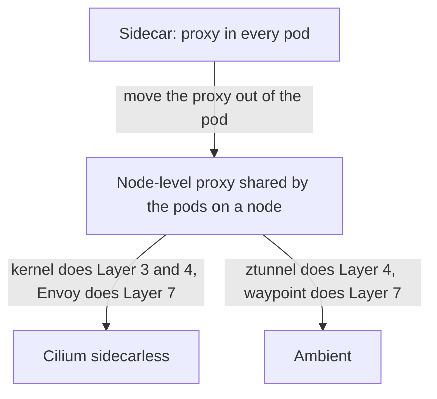

# Comparing Sidecar, Sidecarless And Ambient Designs

Each mesh design puts the proxy in a different place, and each placement moves cost and risk from one place to another. This part compares the sidecar design, the Cilium design and the ambient design on resources, upgrades, failure scope and security boundaries, and it gives the questions that decide which design fits a cluster.

## The three placements

- **Sidecar.** One proxy in every pod. All Layer 4 and Layer 7 work for a pod is done by its own proxy.
- **Cilium sidecarless.** eBPF in the kernel for Layer 3 and Layer 4, and a shared Envoy on each node for Layer 7. Nothing runs inside the application pods.
- **Ambient.** The ambient mode of Istio splits the work in two. A node component called **ztunnel** runs on each node and handles Layer 4: it encrypts connections with mutual TLS and applies identity-based rules. An optional **waypoint proxy**, which is an Envoy deployment for a namespace or a service account, handles Layer 7 for the services that need it.

Ambient and Cilium both remove the proxy from the pod, but they differ in the mechanism. Cilium uses eBPF in the kernel and a node-wide Envoy. Ambient uses a user-space ztunnel on the node and a waypoint proxy that runs as a normal workload in the cluster.



## Compare resource use

The first difference is the one that teams notice on the bill: how much memory and CPU the mesh uses before it handles a single request.

A sidecar mesh needs memory and CPU for each pod, and the total grows with the number of pods. A node-level design needs memory and CPU for each node, and the total grows with the number of nodes. On a cluster with many small pods per node, the second total is much smaller.

The node-level proxy is shared, so its load depends on the busiest workloads on the node. A noisy workload can use the capacity of the node proxy. A sidecar limits this by giving each pod its own proxy with its own limits. When you size a node-level proxy, you size it for the peak of the whole node.

## Compare upgrades

The second difference is who has to act when a new proxy version is released.

A sidecar proxy is part of the pod, so a proxy upgrade is a pod restart, and the application owners decide when it happens. A node-level proxy is upgraded as a DaemonSet, and the platform team decides. This is faster and needs no action from application owners. It also means that a bad upgrade can affect every workload on a node at once, so the rollout must go node by node and must stop when errors appear.

## Compare failure scope

The third difference is how many workloads are affected when a proxy stops working.

If a sidecar crashes, one pod loses its mesh features. If a node-level proxy crashes, every pod on that node that depends on it for Layer 7 loses them until it restarts. Cilium limits this in two ways. Traffic that needs only Layer 3 and Layer 4 never uses Envoy, so a crash of `cilium-envoy` does not affect it. The agent and Envoy are separate pods, so a restart of one does not restart the other.

The smaller scope of a sidecar has a price. Each of many proxies is a place where a bad configuration can arrive, and a control plane that pushes a wrong configuration reaches all of them.

## Compare security boundaries

The fourth difference is which code can reach the proxy and its keys.

A sidecar shares the network namespace of the application. An attacker who controls the application can reach the local port of the proxy, and the proxy holds the certificate of the workload in the same pod. The certificate and the application have the same trust boundary.

A node-level proxy runs outside the pod, as a privileged platform component. The application cannot reach its memory. The trade-off is that the proxy handles the traffic of many tenants, so a flaw in it affects all of them, and the platform team must keep it up to date and isolated.

A design label is not a security guarantee. The words sidecarless and ambient describe where a proxy runs. They do not say whether traffic is encrypted, whether identities are verified, or whether the rules are strict. Check each of these separately.

## Compare the features

| Question | Sidecar | Cilium sidecarless | Ambient |
| --- | --- | --- | --- |
| Where does Layer 7 run? | In the pod | Envoy on the node | In a waypoint proxy |
| Where does Layer 4 run? | In the pod | In the kernel with eBPF | In ztunnel on the node |
| Does a pod restart for a mesh upgrade? | Yes | No | No |
| Cost grows with | Pods | Nodes | Nodes, plus waypoints |
| Encryption in transit | Mutual TLS between sidecars | WireGuard or IPsec between nodes, mutual authentication is optional | Mutual TLS between ztunnels |

## Choose with questions

No single design wins on every point, so the questions below turn the comparison into a decision for one cluster.

- Does the cluster have many small pods? Then a proxy for every pod is expensive, and a node-level design saves resources.
- Do application owners control the restarts of their pods? A design that upgrades without restarts removes a dependency between teams.
- Do you need Layer 7 features for every service, or only for a few? If only a few, a design with Layer 7 on demand uses the proxy only where needed.
- Do you need to run in a managed cluster where you cannot change the node kernel or load eBPF programs? Then check what the provider allows before you pick a design.
- Is the node kernel new enough for the eBPF features that Cilium needs? A very old kernel limits the options.
- Does a rule require identity inside the pod boundary? A node-level proxy uses the identity of the pod, which the node assigns, so check that this meets the requirement.

## Compare designs on your own cluster

Collect the numbers that the questions need:

<!-- astrona:playground:renew -->

```sh
kubectl get nodes --no-headers | wc -l
kubectl get pods -A --no-headers | wc -l
kubectl -n kube-system get pods -l k8s-app=cilium-envoy -o custom-columns=NAME:.metadata.name,CPU:.spec.containers[*].resources.requests.cpu,MEMORY:.spec.containers[*].resources.requests.memory
```

Multiply the proxy requests by the node count for the node-level design. A sidecar proxy typically has its own request, so multiply that request by the pod count. The two products show the difference for your cluster. Where a request is empty, the pod has no request set, so use the real usage that your metrics system shows.

## What you know now

The three designs place the proxy in the pod, on the node with the kernel doing Layer 3 and Layer 4, or on the node with a separate Layer 7 proxy. Moving the proxy out of the pod lowers cost, removes restarts for upgrades and takes the proxy out of the application trust boundary. It also makes the proxy a shared component whose failure and whose upgrade affect a whole node. The right choice depends on the number of pods per node, the owner of upgrades, the need for Layer 7 and the kernel.

## Common pitfalls

> [!WARNING]
> - Comparing only the proxy size per pod misses the number of pods. Compare the totals for the whole cluster.
> - A sidecarless label does not mean encrypted or authenticated. Enable and test those separately.
> - A node-level proxy upgrade reaches a whole node at once. Roll it out one node at a time.
> - A shared proxy needs its own capacity planning. Size it for the busiest node, not for the average.
